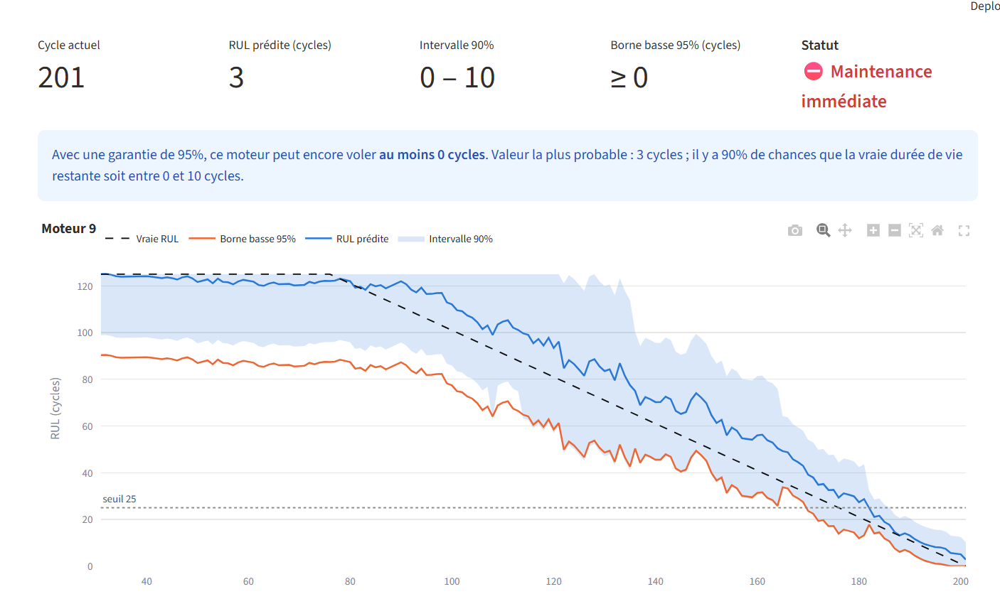
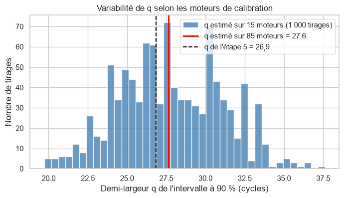
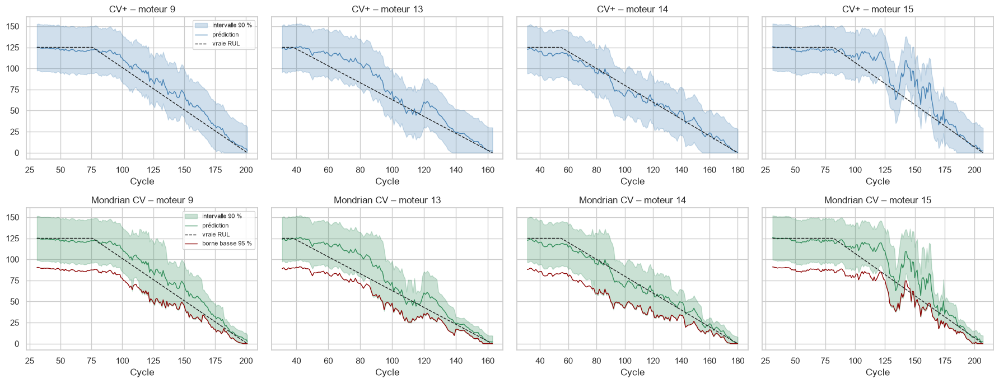
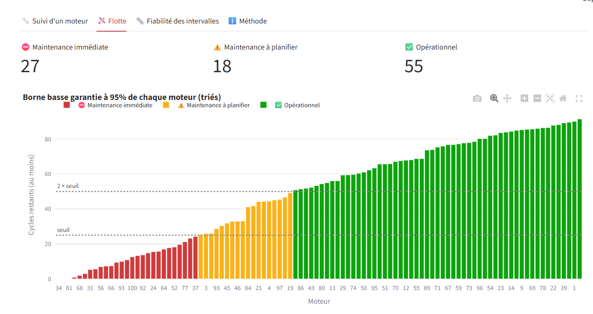

# Maintenance prédictive avec quantification d'incertitude

[](https://rul-conformal-firas.streamlit.app/)

Prédiction de la **durée de vie restante (RUL)** de moteurs d'avion à partir de leurs capteurs (NASA C-MAPSS),
avec des **intervalles de confiance garantis par conformal prediction** et une règle de décision de maintenance
fondée sur une **borne basse garantie**.

> **En une phrase :** sur 100 moteurs de test jamais vus, les intervalles à 90 % couvrent 93 % des vraies RUL, de façon
> stable selon le découpage des données (93 à 95 %). Une décision de maintenance fondée sur la borne basse garantie
> détecte **les 19 moteurs** à moins de 25 cycles de la panne, là où une décision fondée sur la seule prédiction en
> aurait **manqué 3**.

**👉 Tableau de bord en ligne : [rul-conformal-firas.streamlit.app](https://rul-conformal-firas.streamlit.app/)**



---

## Le problème

Un moteur d'avion se dégrade progressivement. Remplacer ses pièces trop tôt coûte cher ; trop tard, c'est dangereux.
Prédire la RUL (le nombre de cycles de vol restants) permet de planifier la maintenance au bon moment.

Mais une prédiction seule ne suffit pas : « il reste 70 cycles » n'est pas exploitable sans savoir à quel point le modèle
est sûr de lui. Ce projet répond à la question que se pose réellement un ingénieur maintenance :
**« combien de cycles puis-je encore voler, avec une garantie de 95 % ? »**

**Données :** [NASA C-MAPSS](https://data.nasa.gov/dataset/cmapss-jet-engine-simulated-data), sous-ensemble FD001 :
100 moteurs suivis jusqu'à la panne pour l'entraînement, 100 moteurs coupés avant la panne pour le test, 21 capteurs.

## Résultats

### 1. Prédiction de la RUL

| Modèle | RMSE test (dernier cycle) | Score NASA | RMSE test (toutes lignes) |
|---|---|---|---|
| **LightGBM** (141 features glissantes) | **13,53** | **308** | 13,86 |
| LSTM (fenêtres de 30 cycles) | 15,74 | 499 | 14,45 |
| LSTM + âge du moteur | 16,36 | 574 | 13,52 |
| Moyenne LightGBM + LSTM âge | 13,87 | 331 | **12,77** |

LightGBM est retenu : il est le plus précis au dernier cycle du test. Sur 3 graines aléatoires, le LSTM obtient
15,65 ± 0,25 (16,20 ± 0,17 avec l'âge) : l'écart avec LightGBM est bien supérieur à la variabilité due à l'initialisation. Le LSTM corrige en partie le retard de LightGBM en milieu de vie, mais ne le
bat pas globalement sur ce volume de données (70 moteurs d'entraînement).

### 2. Intervalles garantis (conformal prediction)

| Méthode | Moteurs de calibration | Couverture test | Couverture validation | Largeur moyenne | Pire tranche (val.) |
|---|---|---|---|---|---|
| Split conformal | 15 | 92 % | 90,3 % | 51,5 | 69 % |
| CQR (MAPIE) | 15 | 92 % | 84,7 % | 53,2 | 75 % |
| Mondrian | 15 | 92 % | 92,3 % | 44,9 | 80 % |
| CV+ | 85 | 94 % | 92,0 % | 54,2 | 73 % |
| **Mondrian CV** (retenue) | **85** | **93 %** | **93,3 %** | 46,5 | **84 %** |

*Objectif : couverture ≥ 90 %. « Pire tranche » : couverture minimale parmi les tranches de vraie RUL (0-25, 25-50…).*

- **L'incertitude s'adapte à l'état du moteur** : ±7 cycles quand la panne est proche, jusqu'à ±36 au début de la
  dégradation.
- **Robustesse vérifiée** : sur 3 autres répartitions des moteurs, la couverture reste entre 93 et 95 % sur le test.
- **Pourquoi calibrer sur 85 moteurs ?** Avec 15 moteurs, la demi-largeur de l'intervalle variait de 22,7 à 33,3 cycles
  selon les moteurs tirés. La validation croisée (CV+) utilise les 85 moteurs à la fois pour entraîner et calibrer.





### 3. Décision de maintenance

Le statut de chaque moteur repose sur la **borne basse garantie à 95 %**, pas sur la prédiction :
⛔ maintenance immédiate si elle passe sous 25 cycles, ⚠️ à planifier sous 50, ✅ opérationnel sinon.

| | Décision sur la prédiction | Décision sur la borne basse |
|---|---|---|
| Moteurs à ≤ 25 cycles de la panne détectés | 16 / 19 | **19 / 19** |
| Plus petite vraie RUL parmi les moteurs ✅ | – | 59 cycles |
| Borne basse respectée sur le test | – | 99 % (objectif 95 %) |

Le coût de cette prudence : 8 moteurs à 26-38 cycles de la panne voient leur maintenance avancée de quelques cycles.



## Méthode

1. **Exploration** : 14 capteurs utiles sur 21 ; dégradation non linéaire qui s'accélère dans les 50 à 100 derniers
   cycles → RUL plafonnée à 125.
2. **Préparation sans fuite** : découpage **par moteur** (jamais par ligne), normalisation ajustée sur le seul
   ensemble d'entraînement, tests unitaires.
3. **Modèles** : LightGBM sur des moyennes, écarts-types et pentes glissants (passé uniquement) ; LSTM en comparaison.
4. **Conformal prediction** : calibration sur des trajectoires coupées aléatoirement pour imiter le jeu de test ;
   split conformal codé à la main et vérifié avec MAPIE ; CQR ; Mondrian ; CV+ sur les 85 moteurs.
5. **Tableau de bord** Streamlit : suivi d'un moteur cycle par cycle, vue de la flotte, vérification de la couverture.

## Limites

- **Tranche 50-75 cycles** : le modèle y annonce la panne trop tard et la couverture reste un peu sous l'objectif en
  validation (84 %). La garantie porte sur ce que voit le modèle (sa prédiction), pas sur la vraie RUL, inconnue.
- **Échangeabilité approximative** : les coupures d'un même moteur sont corrélées entre elles, et la calibration
  contient plus de moteurs en phase saine que le test.
- **Un seul sous-ensemble** (FD001 : une condition de vol, un mode de panne). FD002 à FD004 restent à traiter.
- **Données simulées** : des données réelles de flotte seraient plus bruitées et hétérogènes.

## Structure du projet

```
rul-conformal/
├── app/                  tableau de bord Streamlit (app.py, core.py)
├── data/processed/       données préparées utilisées par le tableau de bord
├── models/               modèle utilisé par le tableau de bord (5 LightGBM + calibration)
├── notebooks/
│   ├── 01_exploration.ipynb
│   ├── 02_preparation.ipynb
│   ├── 03_baseline_lightgbm.ipynb
│   ├── 04_lstm.ipynb
│   ├── 04b_lstm_age.ipynb
│   ├── 05_conformal.ipynb
│   └── 05b_conformal_cv.ipynb
├── reports/figures/      figures du README
├── src/
│   ├── data/             chargement, découpage par moteur, fenêtres temporelles
│   ├── features/         sélection des capteurs, features glissantes
│   ├── models/           LSTM, métriques (RMSE, score NASA)
│   └── conformal/        split conformal, Mondrian, borne basse, CV+ (codés à la main)
└── tests/                tests unitaires (pytest)
```

## Reproduire les résultats

```bash
conda create -n rul python=3.11 -y
conda activate rul
pip install -r requirements.txt
python -m pytest tests
```

1. Télécharger [CMAPSSData.zip](https://data.nasa.gov/docs/legacy/CMAPSSData.zip) et placer `train_FD001.txt`,
   `test_FD001.txt` et `RUL_FD001.txt` dans `data/raw/`.
2. Exécuter les notebooks dans l'ordre (01 → 05b).
3. Lancer le tableau de bord : `streamlit run app/app.py`

## Stack

Python · pandas · scikit-learn · LightGBM · PyTorch · MAPIE · Streamlit · Plotly · pytest

## Références

- A. Saxena, K. Goebel (2008). *Turbofan Engine Degradation Simulation Data Set*. NASA Ames Prognostics Data Repository.
- R. F. Barber, E. J. Candès, A. Ramdas, R. J. Tibshirani (2021). *Predictive inference with the jackknife+*. Annals of Statistics.
- Y. Romano, E. Patterson, E. J. Candès (2019). *Conformalized Quantile Regression*. NeurIPS.
- [MAPIE](https://github.com/scikit-learn-contrib/MAPIE) : bibliothèque de conformal prediction.

## Auteur

**Firas Ghedir** – élève ingénieur en Mathématiques Appliquées et Modélisation, Polytech Nice Sophia.
